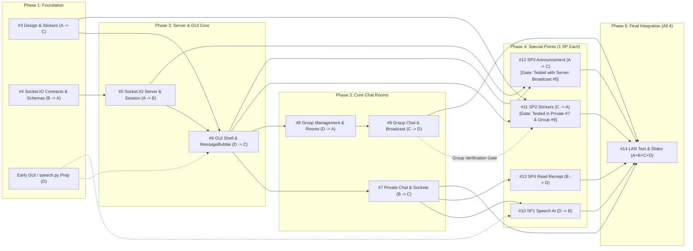

# 4-Person Team Work Plan & Workflow — Simple Chat Application

- **GitHub Repository**: [sininant/Simple-Chat-Application](https://github.com/sininant/Simple-Chat-Application)
- **GitHub Issues**: [Issues #3 – #14](https://github.com/sininant/Simple-Chat-Application/issues)
- **Reference Documentation**:
  - [README.md](https://github.com/sininant/Simple-Chat-Application/blob/main/README.md) — Project overview and setup instructions
  - [docs/protocol.md](https://github.com/sininant/Simple-Chat-Application/blob/main/docs/protocol.md) — Shared JSON wire protocol specification
  - [GLOSSARY.md](https://github.com/sininant/Simple-Chat-Application/blob/main/GLOSSARY.md) — Canonical domain terms and core class names
  - [docs/project-ideas.md](https://github.com/sininant/Simple-Chat-Application/blob/main/docs/project-ideas.md) — System architecture, baseline UI layout, and Special Points

---

## Team Members and Primary Tracks

| Role | Full Name | GitHub | Phase Progression (Core Track + 1 Special Point Each) |
| :---: | :--- | :--- | :--- |
| **`A`** | Pornpanit Kingchongcharoensuk | [`@praisepany`](https://github.com/praisepany) | **P1** Design (`#3`) → **P2** Server/Session (`#5`) → **P4** `SP3` Announcement (`#12`) |
| **`B`** | Worawalan Samai | [`@worawalan-s`](https://github.com/worawalan-s) | **P1** Protocol (`#4`) → **P3** Private Chat (`#7`) → **P4** `SP4` Read Receipt (`#13`) |
| **`C`** | Jiruchya Niamluang | [`@noeyyneo`](https://github.com/noeyyneo) | **P3** Group Chat (`#9`) → **P4** `SP2` Stickers (`#11`) → **P5** Lead `R1` Diagram & Slides (`#14`) |
| **`D`** | Sininant Wiriyakulnant | [`@sininant`](https://github.com/sininant) | **P2** GUI Shell (`#6`) → **P3** Group Manage (`#8`) → **P4** `SP1` AI Speech (`#10`) |

---

## 1. Shared Team Checkpoints (`A + B + C + D`)

There are **3 key checkpoints** that all 4 team members complete together to keep modules aligned and prepare for the final defense:

### 1.1 Kick-off Sync (Before Phase 1 — ~30 mins)
- Merge [PR #16](https://github.com/sininant/Simple-Chat-Application/pull/16) (Baseline 2-Screen UI Layout) into `main`.
- Review the shared contracts in `docs/protocol.md` and `GLOSSARY.md` so everyone uses identical Socket.IO event names and payload schemas.
- Align on the predefined sticker IDs (`sticker_id`) and visual UI direction for [Issue #3](https://github.com/sininant/Simple-Chat-Application/issues/3).
- **Mandatory PR Evidence Rule**: Because the course presentation requires **two Code Snapshot boxes per requirement (e.g., Server + Client/GUI)** and the **Generative AI Prompt (if used)**, every member must record both items directly in their PR description when opening a PR.

### 1.2 Mid-Project Sync (After Phase 2: Issues #5 and #6 — ~20 mins)
- **`A` (Pornpanit)** walks the team through `ChatEngine` and `ClientSession` from [Issue #5](https://github.com/sininant/Simple-Chat-Application/issues/5).
- **`D` (Sininant)** walks the team through `gui.py` and the Global Reusable Components from [Issue #6](https://github.com/sininant/Simple-Chat-Application/issues/6).
- After this sync, everyone can branch out independently to build Phase 3–4 chat room features and Special Points in parallel without bottlenecks.

### 1.3 Final Integration, Physical LAN Test & Presentation ([Issue #14](https://github.com/sininant/Simple-Chat-Application/issues/14))
- **Physical Multi-Computer LAN Test (`R1` — Mandatory Gate for Parts 2 & 3)**: Run `server.py` on one machine and launch `gui.py` from at least 2 separate physical computers on the same Wi-Fi/LAN network, verifying `R2`–`R11` and `SP1`–`SP4` end to end.
- **Slide Deck Assembly & Q&A Rehearsal**: Combine each member's Code Snapshots and AI Prompts into the final presentation deck (each member presents their core modules plus their assigned Special Point) and rehearse the lecture theory connections (`Presentation/Session Layer`, `TCP 4-tuple`, `Socket Door & Multi-threading`, `rdt2.0 ACK`).

---

## 2. Workload Balance Summary (`A`, `B`, `C`, `D`)

This allocation ensures **every member works across both Network/Backend and UI**, **code review load offsets implementation ticket counts**, and **everyone owns exactly 1 Special Point in Phase 4**:

| Member | Implementation (Owner) | Code Review (Reviewer) | Workload Rationale |
| :--- | :--- | :--- | :--- |
| **`A` (Pornpanit)** | **3 Tickets**: [#3](https://github.com/sininant/Simple-Chat-Application/issues/3) (P1), [#5](https://github.com/sininant/Simple-Chat-Application/issues/5) (P2), [#12](https://github.com/sininant/Simple-Chat-Application/issues/12) (`SP3` - P4) | **3 Tickets**: [#4](https://github.com/sininant/Simple-Chat-Application/issues/4), [#8](https://github.com/sininant/Simple-Chat-Application/issues/8), [#11](https://github.com/sininant/Simple-Chat-Application/issues/11) | Starts with Figma & sticker assets (`#3`), implements the Socket.IO Server/Session engine (`#5`) in Phase 2, reviews server-side group logic in Phase 3, and implements `SP3` Announcement broadcast (`#12`) in Phase 4. |
| **`B` (Worawalan)** | **3 Tickets**: [#4](https://github.com/sininant/Simple-Chat-Application/issues/4) (P1), [#7](https://github.com/sininant/Simple-Chat-Application/issues/7) (P3), [#13](https://github.com/sininant/Simple-Chat-Application/issues/13) (`SP4` - P4) | **2 Tickets**: [#5](https://github.com/sininant/Simple-Chat-Application/issues/5), [#10](https://github.com/sininant/Simple-Chat-Application/issues/10) | Defines Socket.IO event contracts & validators (`#4`), reviews `#5` in Phase 2, and owns the end-to-end 1-to-1 private messaging track across Phase 3 (`#7`) and Phase 4 (`#13` Read Receipt). |
| **`C` (Jiruchya)** | **2 Tickets + Lead `R1` & Slides**: [#9](https://github.com/sininant/Simple-Chat-Application/issues/9) (P3), [#11](https://github.com/sininant/Simple-Chat-Application/issues/11) (`SP2` - P4) + Lead `R1` Diagram & Slides in [#14](https://github.com/sininant/Simple-Chat-Application/issues/14) | **4 Tickets**: [#3](https://github.com/sininant/Simple-Chat-Application/issues/3), [#6](https://github.com/sininant/Simple-Chat-Application/issues/6), [#7](https://github.com/sininant/Simple-Chat-Application/issues/7), [#12](https://github.com/sininant/Simple-Chat-Application/issues/12) | Guards UI/UX consistency by reviewing `#3, #6, #7, #12`, implements Group Chat rooms (`#9`) and `SP2` Stickers (`#11`), and leads the `R1` System Architecture Diagram and slide deck formatting in `#14`. |
| **`D` (Sininant)** | **3 Tickets**: [#6](https://github.com/sininant/Simple-Chat-Application/issues/6) (P2), [#8](https://github.com/sininant/Simple-Chat-Application/issues/8) (P3), [#10](https://github.com/sininant/Simple-Chat-Application/issues/10) (`SP1` AI - P4) | **2 Tickets**: [#9](https://github.com/sininant/Simple-Chat-Application/issues/9), [#13](https://github.com/sininant/Simple-Chat-Application/issues/13) | Builds the core `gui.py` 2-screen shell (`#6`) in Phase 2, extends it with Group creation/discovery/join (`#8`) in Phase 3, and delivers the mandatory AI feature `SP1` Speech-to-Text (`#10`) in Phase 4. |

---

## 3. Phase-by-Phase `Owner` → `Reviewer` Pairing

### Phase 1: Design & Protocol Foundation (Parallel Start from Day 1)

| Ticket | Scope | Owner | Reviewer | Review Focus |
| :--- | :--- | :---: | :---: | :--- |
| **[#3](https://github.com/sininant/Simple-Chat-Application/issues/3)** | Create 2-screen Figma design + predefined `.png` sticker pack in `assets/stickers/` | **`A`** | **`C`** | `C` verifies that UI placements cover every required feature before `D` builds `gui.py` in `#6`. |
| **[#4](https://github.com/sininant/Simple-Chat-Application/issues/4)** | Define Socket.IO event contracts, payload schemas, and client/server event validators (`R2`) | **`B`** | **`A`** | `A` immediately consumes event definitions and payload models in `#5` (`server.py` and `ClientSession`). |

> **Early Prep During Phase 1 for `C` and `D` (No Idle Waiting):**
> - **`D`**: Can scaffold initial CustomTkinter layout classes for `#6` and begin researching the AI model / writing standalone `speech.py` (`SpeechTranscriber` + `tests/test_speech.py`) ahead of `#10` (`SP1`).
> - **`C`**: Reviews `#3` and can begin drafting the Part 1 System Architecture Diagram (`R1`) and presentation slide template.

### Phase 2: Core Server/Session Engine & GUI Shell

| Ticket | Scope | Owner | Reviewer | Review Focus |
| :--- | :--- | :---: | :---: | :--- |
| **[#5](https://github.com/sininant/Simple-Chat-Application/issues/5)** | Implement `server.py` (`socketio.Server` with room and session management) and `client.py` (`socketio.Client` session wrapper for login & presence — `R2, R3, R4`) | **`A`** | **`B`** | `A` transitions from Phase 1 Design to the Socket.IO Server/Session core; `B` (author of `protocol.py` event contracts) reviews event names, room usage, and `ClientSession` APIs before `#7`. |
| **[#6](https://github.com/sininant/Simple-Chat-Application/issues/6)** | Build `gui.py` (CustomTkinter 2-screen UI shell, Global Reusable Components, login & presence wiring — `R3, R4, R5, R6`) | **`D`** | **`C`** | `D` builds the UI shell from `#3`'s Figma (layout work can start alongside `#5`, then wire `ClientSession`); `C` checks design fidelity and reusable component boundaries. |

### Phase 3: Core Chat Rooms — Private & Group Chat (`B`, `D`, `C`)

| Ticket | Scope | Owner | Reviewer | Review Focus |
| :--- | :--- | :---: | :---: | :--- |
| **[#7](https://github.com/sininant/Simple-Chat-Application/issues/7)** | Implement 1-to-1 private chat room tabs and direct message routing (`R5, R6, R7`) | **`B`** | **`C`** | `C` verifies clean usage of `ChatRoomTab` / `MessageBubble` components and reuses the same room tab pattern in `#9`. |
| **[#8](https://github.com/sininant/Simple-Chat-Application/issues/8)** | Implement group creation (creator-only initially), group list with members, and voluntary join (`R8, R9, R10`) | **`D`** | **`A`** | `D` extends the sidebar in `gui.py`; `A` (author of `ChatEngine` in `#5`) reviews server-side group state and thread safety. |
| **[#9](https://github.com/sininant/Simple-Chat-Application/issues/9)** | Implement group chat room tabs and member-only message routing (`R5, R6, R11`) _(starts right after `#8`)_ | **`C`** | **`D`** | `D` (author of `#6` GUI shell and `#8` group membership) verifies group tab integration and strict member-only delivery (`R11`). |

### Phase 4: Special Points — 1 SP per Member (`A`, `B`, `C`, `D`)

| Ticket | Special Point (1.0 pt each) | Owner | Reviewer | Assignment & Review Focus |
| :--- | :--- | :---: | :---: | :--- |
| **[#10](https://github.com/sininant/Simple-Chat-Application/issues/10)** | **SP1 (Mandatory AI)**: Client-side Speech-to-Text microphone input | **`D`** | **`B`** | `D` wires `speech.py` into `gui.py`; `B` (author of `#7` chat send flow) verifies background audio threading so the UI never freezes. |
| **[#11](https://github.com/sininant/Simple-Chat-Application/issues/11)** | **SP2**: Predefined sticker picker popup and `sticker_id` image rendering *(Early start after #6; Integration gate: verified in both Private #7 and Group #9)* | **`C`** | **`A`** | `C` extends `MessageBubble` for sticker rendering across private and group rooms; `A` (creator of `#3` sticker assets) verifies image rendering and missing-file fallbacks.<br><br>**Integration Gate**: Final sign-off on #11 requires verifying sticker transmission and rendering in both 1-to-1 private chat (#7) and group chat rooms (#9). Development can start as soon as #6 provides the picker/bubble components, but the PR cannot be completed until validated against #9. |
| **[#12](https://github.com/sininant/Simple-Chat-Application/issues/12)** | **SP3**: Server-wide one-to-all announcement broadcast and top alert banner *(UI prep after #6; Integration gate: server broadcast with #5)* | **`A`** | **`C`** | `A` implements the one-to-all broadcast on `server.py` (`#5`); `C` reviews the top `AnnouncementBanner` layout in `gui.py` (`#6`).<br><br>**Integration Gate**: Final acceptance requires verifying that an announcement broadcast is received simultaneously across >= 2 connected client instances. Client-side banner UI work alone does not complete #12. |
| **[#13](https://github.com/sininant/Simple-Chat-Application/issues/13)** | **SP4**: Automatic `READ_ACK` (`Read ✓✓`) when viewing private messages | **`B`** | **`D`** | `B` extends `#7` private chat with `rdt2.0`-style read acknowledgments; `D` (author of `gui.py`) verifies active-tab focus detection before firing `READ_ACK`. |

### Phase 5: Multi-Computer LAN Verification & Final Presentation (All 4 Members)

| Ticket | Scope | Owner | Reviewer | Sub-Responsibilities |
| :--- | :--- | :---: | :---: | :--- |
| **[#14](https://github.com/sininant/Simple-Chat-Application/issues/14)** | Finalize Part 1 architecture diagram, 2-computer LAN test (`R1`), and slide code snapshots | **`A+B+C+D`** | **All 4 Members** | • **`C` (Lead `R1` & Slides)**: Draw System Architecture Diagram (`R1`) + unify slide theme + slides for `R11` and `SP2`<br>• **`A`**: Socket Door / Threading / TCP 4-tuple theory + slides for `R3, R4` and `SP3`<br>• **`B`**: Presentation/Session Layer theory + slides for `R2 (Framing), R7` and `SP4`<br>• **`D`**: Slides for `R5, R6 (GUI Shell), R8–R10` and `SP1` (AI model name, reference, and Code Snapshot) |

---

## 4. Workflow & Dependency Graph



---

## 5. Git & Collaboration Rules (Conflict Prevention)

1. **One Branch per Issue**: Create a dedicated feature branch off `main` (e.g., `feat/issue-4-protocol`, `feat/issue-7-private-chat`) and open a Pull Request requesting review from the assigned **Reviewer** in Section 3.
2. **Run Tests Before Every PR**:
   ```bash
   pytest -v
   ```
   (GitHub Actions CI runs automatically on every PR.)
3. **Global Component Rule for `gui.py`**: During Phases 3–4 when multiple features touch the UI, isolate new widgets or popups into self-contained component classes rather than monolithic methods, and always run `git pull --rebase origin main` before opening a PR.
4. **Capture Presentation Evidence in Every PR Description**:
   - `Closes #<issue-number>`
   - **Code Snapshot Points**: Note the 2 key files/functions (e.g., 1 Server snippet + 1 Client/GUI snippet) for the course slides.
   - **Generative AI Prompt (if used)**: Record the prompt used for that ticket (or write `None` if written completely by hand).
